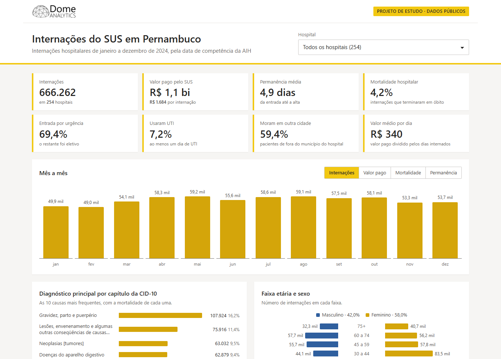
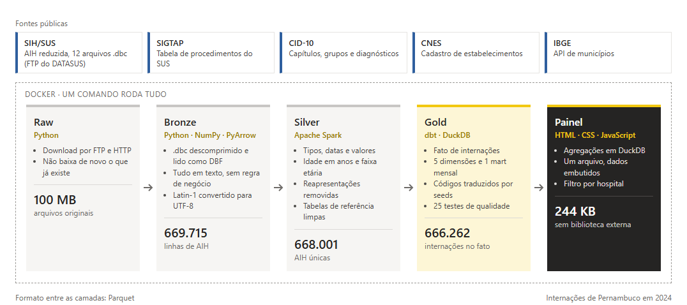

# Internações do SUS em Pernambuco

Pipeline de dados de ponta a ponta com as internações hospitalares do SUS em Pernambuco em 2024.
Os arquivos públicos do DATASUS passam por camadas bronze, silver e gold, com Apache Spark e dbt,
e o resultado é um painel em HTML que abre direto no navegador.

- **Painel ao vivo:** [projetos.domeanalytics.com.br/demos/internacoes-sus-pernambuco](https://projetos.domeanalytics.com.br/demos/internacoes-sus-pernambuco/)
- **Estudo de caso:** [projetos.domeanalytics.com.br/internacoes-sus-pernambuco](https://projetos.domeanalytics.com.br/internacoes-sus-pernambuco/)



É um projeto de estudo da [Dome Analytics](https://www.domeanalytics.com), feito só com dados
públicos. Não tem relação com o Ministério da Saúde nem com os hospitais que aparecem no painel.

## Arquitetura



| Camada | Ferramenta | O que acontece | Saída |
|---|---|---|---|
| Raw | Python | Baixa as cinco fontes. Arquivo que já existe não é baixado de novo. | `dados/raw` |
| Bronze | Python, NumPy, PyArrow | Descomprime os `.dbc`, lê o DBF e grava Parquet com todas as colunas em texto. Converte os arquivos de referência de Latin-1 para UTF-8. | `dados/bronze` |
| Silver | Apache Spark (modo local) | Tipos, datas e valores corretos, idade em anos, faixa etária, remoção das linhas repetidas de cada AIH e tabelas de referência limpas. | `dados/silver` (Parquet particionado por competência) |
| Gold | dbt com DuckDB | Modelo dimensional: fato de internações, cinco dimensões e um mart mensal por hospital, com testes. | `dados/gold` (Parquet) |
| Painel | DuckDB e HTML, CSS e JavaScript | Agrega a gold e gera um único HTML com os dados embutidos. | `dados/painel/index.html` |

Tudo roda num contêiner Docker com Python 3.12 e Java 17.

## Fontes

| Fonte | O que é | Onde |
|---|---|---|
| SIH/SUS, AIH reduzida (RD) | Uma linha por internação paga pelo SUS, um arquivo por mês | FTP do DATASUS, `RDPE24MM.dbc` |
| SIGTAP | Tabela de procedimentos, com grupo, subgrupo e forma de organização | FTP do DATASUS, competência de dezembro do ano |
| CID-10 | Capítulos, grupos, categorias e subcategorias | Site do DATASUS, `CID10CSV.zip` |
| CNES | Cadastro dos estabelecimentos de saúde | OpenDataSUS |
| Municípios | Nome e região de cada município | API de localidades do IBGE |

## Como rodar

Precisa de Docker. Na raiz do projeto:

```bash
docker compose build
docker compose run --rm pipeline
```

O primeiro comando monta a imagem e o segundo roda as cinco etapas em sequência
([pipeline.sh](pipeline.sh)). Ao final, abra `dados/painel/index.html` no navegador.

O ano e o estado vêm das variáveis `ANO` (padrão 2024) e `UF` (padrão PE):

```bash
ANO=2023 docker compose run --rm pipeline
UF=PB docker compose run --rm pipeline
```

Cada execução usa só os arquivos do ano e do estado pedidos. Os de execuções anteriores continuam
em `dados/raw` e `dados/bronze` e são reaproveitados quando você voltar a eles. A silver, a gold e o
painel são refeitos para o recorte atual. O título do painel traz o nome do estado só para
Pernambuco; nos outros aparece a sigla.

Com os arquivos já baixados, o pipeline inteiro leva cerca de um minuto.

Para rodar só uma parte, por exemplo o dbt:

```bash
docker compose run --rm -w /app/dbt pipeline dbt build
```

No Git Bash do Windows, coloque `MSYS_NO_PATHCONV=1` antes do comando, senão o caminho `/app/dbt` é convertido para um caminho do Windows.

## Estrutura

```
ingestao/baixar.py      download das fontes (raw)
ingestao/bronze.py      .dbc e .zip para Parquet e UTF-8 (bronze)
spark/silver.py         limpeza e tabelas de referência com PySpark (silver)
dbt/                    modelo dimensional e testes (gold)
  seeds/                tradução dos códigos do SIH (sexo, raça/cor, caráter, leito, complexidade)
  models/staging/       uma view por tabela da silver
  models/marts/         fato, dimensões e mart mensal, gravados como Parquet
  tests/                testes de regra de negócio
painel/                 gerador do painel (gerar.py, template, CSS e JS)
amostras/               amostra em CSV para estudo e o script que a gera
trilha/                 código esperado ao fim de cada módulo da trilha de estudo
pipeline.sh             as cinco etapas em sequência
```

## Amostra para estudo

A pasta `amostras/` tem um CSV pequeno para quem está aprendendo SQL e não quer rodar o pipeline:
[internacoes-recife-2024-03.csv](amostras/internacoes-recife-2024-03.csv), com as 9.786 internações
de moradores do Recife na competência de março de 2024 (1,4 MB). Cada linha é uma internação, com
datas, sexo, idade, hospital, capítulo da CID, caráter do atendimento, dias de permanência, uso de
UTI, óbito e valor pago. Os nomes do hospital e do capítulo já vêm resolvidos, então dá para
consultar o arquivo sozinho, sem as dimensões. No DuckDB:

```sql
select count(*) from 'internacoes-recife-2024-03.csv' where usou_uti;
```

Para praticar joins, há as mesmas internações com os códigos no lugar dos nomes e duas tabelas de
apoio, só com os códigos que aparecem nelas:

- [internacoes-codigos-recife-2024-03.csv](amostras/internacoes-codigos-recife-2024-03.csv): `cnes`
  e `cod_cid` no lugar de `hospital` e `capitulo_cid`;
- [hospitais-recife-2024-03.csv](amostras/hospitais-recife-2024-03.csv): CNES, nome e município dos
  59 hospitais;
- [diagnosticos-recife-2024-03.csv](amostras/diagnosticos-recife-2024-03.csv): código CID,
  diagnóstico, categoria e capítulo dos 1.476 códigos.

Os arquivos saem da gold pelo [amostras/gerar.py](amostras/gerar.py). Depois de rodar o pipeline de
2024 para PE:

```bash
docker compose run --rm pipeline python amostras/gerar.py
```

Outra competência vai como argumento (`python amostras/gerar.py 2024-05`). A amostra é usada nos
exercícios da trilha de estudo da Dome Analytics, e as respostas dos exercícios saem dela. Por isso o
arquivo fica no repositório e só muda quando os exercícios forem revistos.

## Marcos da trilha

A pasta `trilha/` tem o código esperado ao fim de cada módulo da trilha de estudo, e cada etapa tem
uma tag do Git com o mesmo nome. Hoje existem três:

- [trilha/etapa-3-python](trilha/etapa-3-python/): o script do Módulo 3 que baixa as tabelas de
  referência.
- [trilha/etapa-4-docker](trilha/etapa-4-docker/): o Dockerfile e o `docker-compose.yml` do Módulo 4,
  que rodam esse script num contêiner.
- [trilha/etapa-5-bronze](trilha/etapa-5-bronze/): o `baixar.py` e o `bronze.py` do Módulo 5, que
  baixam o RD de um ano e gravam a camada bronze.

Para ver o repositório como estava num marco, use `git checkout` com o nome dele, como
`git checkout etapa-5-bronze`.

## Modelo da camada gold

- **fato_internacao:** uma linha por AIH, com datas, hospital, municípios de residência e de
  internação, procedimento, diagnóstico, perfil do paciente, permanência, UTI, óbito e valores.
  Os códigos do SIH já vêm traduzidos pelos seeds. Também traz `usou_uti` e
  `internado_fora_do_municipio`.
- **dim_tempo, dim_municipio, dim_estabelecimento, dim_procedimento, dim_diagnostico.**
- **mart_indicadores_mensais:** competência e hospital, com internações, óbitos, mortalidade,
  permanência média, uso de UTI, valor pago e parte das entradas por urgência.

O dbt grava as tabelas como Parquet (materialização `external` do dbt-duckdb), então qualquer
ferramenta que leia Parquet usa a gold sem depender do arquivo do DuckDB.

### Testes

São 25 testes no `dbt build`:

- Chaves únicas e não nulas em fato e dimensões.
- Relacionamentos do fato com cada dimensão.
- Valores aceitos no tipo de entrada (eletiva ou urgência).
- Três testes de regra de negócio:
  - a data de saída nunca é anterior à data de internação;
  - nenhum valor pago é negativo;
  - o total de internações da gold bate com o da silver.

Dois testes de relacionamento são só avisos. O SIH usa o código N18.5, que não existe na tabela da
CID-10 de 2008 que o DATASUS publica. E o SIGTAP usado é o de dezembro do ano, onde faltam alguns
procedimentos cobrados em meses anteriores: em 2024 nenhum, em 2023 quatro códigos, somando 32
internações. As internações continuam no fato, sem o nome do procedimento.

## Decisões e aprendizados

**Pasta montada do Windows.** A biblioteca que descomprime o `.dbc` lê o arquivo em pedaços
pequenos. Dentro do contêiner, lendo direto da pasta do Windows montada como volume, cada arquivo
levava mais de 6 minutos. Copiando o arquivo antes para o disco do próprio contêiner, a mesma
descompressão leva menos de 1 segundo. A camada bronze inteira caiu de mais de uma hora para 41 segundos.

**Leitor de DBF com NumPy.** O DBF tem registros de tamanho fixo, então o arquivo inteiro vira
uma matriz de bytes e cada campo é uma fatia de colunas. Assim o arquivo é lido de uma vez, sem
percorrer registro por registro em Python.

**AIH repetida.** A AIH de longa permanência (tipo 5) é paga mês a mês e volta em cada competência
com o mesmo número. A silver fica só com a competência mais recente de cada AIH e remove 1.714
linhas, todas de AIH tipo 5. A AIH tipo 1 não se repete entre competências. Em 16 AIH, duas contas
caem na mesma competência, e fica a de data de saída mais recente.

**AIH tipo 1.** O fato considera só a AIH principal. A AIH tipo 5 continua uma internação de longa
permanência e contaria a mesma internação duas vezes.

**Texto em Latin-1.** Os arquivos do DATASUS vêm em Latin-1. A conversão para UTF-8 acontece na
bronze, assim o Spark e o dbt leem tudo sem tratar codificação.

**Painel sem biblioteca.** O painel é um arquivo só, com HTML, CSS e JavaScript e os dados
embutidos em JSON. Abre sem servidor, sem internet e sem nenhuma dependência externa. Os 40
hospitais com mais internações têm recorte próprio, escolhido no filtro ou clicando na tabela.

## Números de 2024

| Indicador | Valor |
|---|---|
| Linhas lidas dos arquivos do SIH | 669.715 |
| AIH únicas depois de remover as repetidas | 668.001 |
| Internações no fato (AIH tipo 1) | 666.262 |
| Hospitais | 254 |
| Valor pago pelo SUS | R$ 1,12 bilhão |
| Permanência média | 4,9 dias |
| Mortalidade hospitalar | 4,2% |
| Entradas por urgência | 69,4% |
| Internações com UTI | 7,2% |
| Pacientes internados fora do município onde moram | 59,4% |

## Limites

- **Competência.** A competência é o mês em que a conta foi aprovada, que nem sempre coincide com o
  mês da internação. Internações do fim do ano apresentadas só em 2025 não entram.
- **CNES.** O cadastro do CNES é o atual, então nome e esfera do hospital refletem a situação de hoje.
- **Mortalidade.** A mortalidade depende do perfil de cada hospital (porte, UTI, casos graves) e
  não serve para comparar a qualidade do atendimento.

## Licença

O código está sob a [licença MIT](LICENSE). Os dados são públicos e pertencem às fontes:
DATASUS (SIH/SUS, SIGTAP, CID-10 e CNES) e IBGE.
